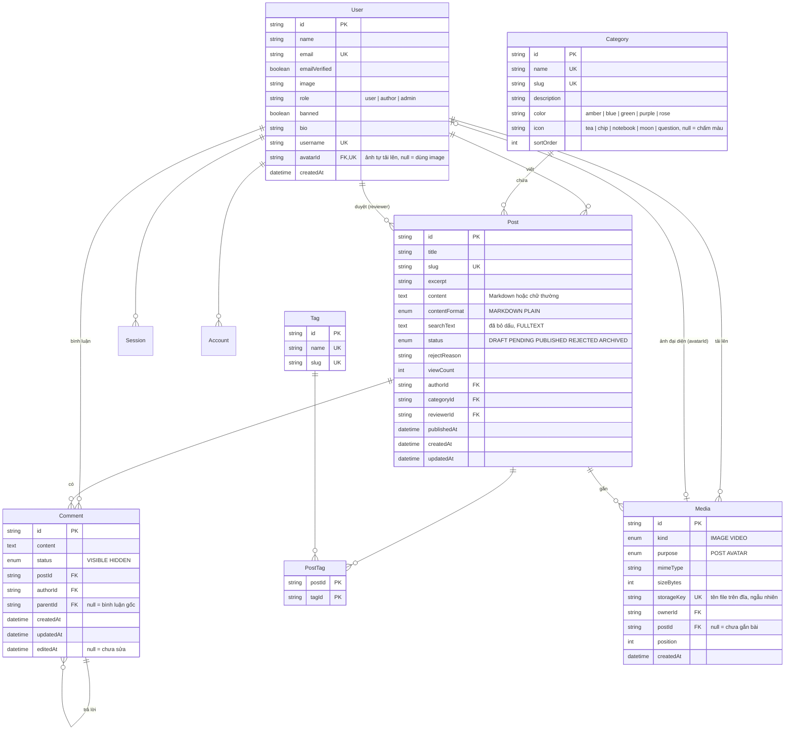

# Cơ sở dữ liệu

MySQL 8.4, bảng mã `utf8mb4`, collation `utf8mb4_0900_ai_ci`. Truy cập qua Prisma. Xem dữ liệu bằng Adminer ở http://localhost:8080 (server: `mysql`, user/mật khẩu trong `.env`).

## Sơ đồ quan hệ

`Session`, `Account`, `Verification` do Better Auth quản lý. Sinh schema của chúng bằng CLI của Better Auth (xem tài liệu bản đã cài), rồi thêm các cột riêng của Xóm Nhỏ (`bio`, `username`) vào model `User`. Plugin admin tự thêm `role`, `banned`, `banReason`, `banExpires`.

Hiện trạng (giai đoạn 2, better-auth 1.7): `session`, `account`, `verification` thêm ở migration `add_better_auth_tables`, cột lấy đúng theo định nghĩa bảng trong mã nguồn Better Auth (bảng core + `session.impersonatedBy` của plugin admin), không dùng CLI vì cấu hình Better Auth nằm trong Nest. Id của bốn bảng auth do Better Auth sinh (32 ký tự), không phải `cuid()`. `username` tự sinh khi đăng ký (từ tên, bỏ dấu, trùng thì thêm số, `infrastructure/auth/username.ts`). Mật khẩu băm nằm ở `account.password` với `providerId = "credential"`; không repository nào đọc bảng `account`, `session`.

Nâng cấp Better Auth lên bản mới: so lại cột với `@better-auth/core/dist/db/get-tables.mjs` và schema của plugin admin; lệch thì tạo migration mới.

Ghi chú cài đặt:

- Tên bảng viết thường, số ít, gạch dưới (`user`, `post`, `post_tag`) qua `@@map`; tên cột giữ camelCase như Better Auth.
- `Post.contentFormat`: `MARKDOWN` (bài kiểu diễn đàn, có trước) hoặc `PLAIN` (soạn ở trang chủ, ADR 0008). Bài soạn ở trang chủ có thể có `title` rỗng.
- `Media`: ảnh, video tải lên (ADR 0005). File nằm trên đĩa backend (`UPLOAD_DIR`, mặc định `media/` ở gốc repo), đường dẫn là `storageKey` dạng `<thư mục>/<uuid>.<đuôi>`: thư mục `images` hoặc `videos` theo `kind`, `avatars` cho ảnh đại diện; đuôi do backend chọn theo chữ ký nhị phân. `purpose` cho biết file dùng vào đâu: `POST` (ảnh, video trong bài: tải lên trước với `postId = null`, gắn khi đăng bài) hay `AVATAR` (ảnh đại diện: `postId` luôn `null`, `user.avatarId` trỏ tới). Xóa bài thì xóa dòng media (cascade); gỡ file khỏi bài khi sửa thì xóa dòng. Cả hai trường hợp backend xóa file trên đĩa sau khi transaction xong (`posts.service.ts`). Chỉ gắn được file `purpose = POST` vào bài. Việc dọn file không gắn bài **phải bỏ qua `AVATAR`**.
- `Comment`: trả lời chỉ một cấp, `parentId` luôn trỏ về bình luận gốc. Xóa bình luận gốc thì trả lời bị xóa theo (`onDelete: Cascade`). `editedAt` ghi lần người viết sửa nội dung; không dùng `updatedAt` để hiện "đã sửa" vì trưởng xóm ẩn, hiện bình luận cũng đổi cột đó.
- `User.avatarId`: ảnh đại diện tự tải lên (`PUT /me/avatar`). Có thì hiện ảnh này, không thì hiện `image` (link từ Google, GitHub). Đổi ảnh hay xóa ảnh thì backend xóa dòng media cũ và file trên đĩa; xóa dòng media thì `avatarId` tự về `null` (`ON DELETE SET NULL`).
- `Post.content` là `MEDIUMTEXT` (16 MB): `TEXT` chỉ 64 KB, bài tiếng Việt dài (mỗi chữ có dấu 2-3 byte) dễ vượt.
- Server MySQL mặc định `utf8mb4_0900_ai_ci`, nhưng Prisma tạo từng bảng với `utf8mb4_unicode_ci` và không theo dõi collation. Giữ nguyên `unicode_ci` cho mọi bảng (không sửa tay migration) để các bảng luôn đồng nhất. Cả hai collation đều không phân biệt dấu khi so sánh, nên cột `UNIQUE` coi "bàn" và "ban" là trùng (hai tag này không cùng tồn tại được). Đây là hành vi mong muốn cho tên tag, danh mục. Tìm kiếm không phụ thuộc collation vì `searchText` đã bỏ dấu sẵn.
- Kết nối qua driver adapter `@prisma/adapter-mariadb` (Prisma 7 bắt buộc dùng adapter). `DATABASE_URL` khai báo trong `backend/prisma.config.ts` (file này trỏ tới `database/prisma/`), không còn trong `schema.prisma`.

## Quy ước

- Khóa chính: chuỗi `cuid()` (hoặc id do Better Auth sinh cho bảng của nó), không dùng số tự tăng lộ ra URL.
- URL dùng `slug`, không dùng `id`. Slug sinh từ tiêu đề đã bỏ dấu (`api/src/utils/slugify.ts`), trùng thì thêm hậu tố `-2`, `-3`.
- Mọi bảng có `createdAt`; bảng sửa được có `updatedAt @updatedAt`.
- Xóa bài: xóa thật kèm bình luận (`onDelete: Cascade`). Xóa người dùng: không cho xóa nếu còn bài; dùng `banned` thay thế.
- Enum đặt tên tiếng Anh viết hoa (`PUBLISHED`), tên hiển thị tiếng Việt nằm ở `api/src/constants`.

## Chỉ mục

| Bảng    | Chỉ mục                             | Phục vụ                          |
| ------- | ----------------------------------- | -------------------------------- |
| Post    | `(status, publishedAt DESC)`        | Trang chủ: bài mới nhất đã đăng  |
| Post    | `(categoryId, status, publishedAt)` | Lọc theo danh mục                |
| Post    | `(authorId, status, publishedAt)`   | Bài của tôi, hồ sơ (`?author=`)  |
| Post    | `FULLTEXT(searchText)`              | Tìm kiếm                         |
| Media   | `(postId, position)`                | Ảnh, video của bài theo thứ tự   |
| Media   | `(ownerId, postId, createdAt)`      | File chưa gắn bài (gắn, dọn rác) |
| Comment | `(postId, status, createdAt)`       | Bình luận dưới bài               |
| Comment | `(parentId)`                        | Trả lời                          |
| PostTag | `(tagId)`                           | Lọc theo tag                     |

Không có index cho `Post.viewCount` (tab "Nhiều người đọc"): cột bị ghi mỗi lượt xem. Đánh đổi có chủ ý, xem lại ở giai đoạn 7 nếu bài nhiều.

## Tìm kiếm tiếng Việt

Vấn đề: người dùng hay gõ không dấu ("ban tron"), và collation của MySQL không coi `đ` và `d` là một.

Cách làm:

1. Cột `Post.searchText` = tiêu đề + tóm tắt + tên tag, **chuyển chữ thường, bỏ dấu, đổi `đ` thành `d`**. Chỉ tạo bằng `buildPostSearchText` (`backend/src/modules/posts/posts.search-text.ts`, dùng `toSearchText` của `api`), không tự ghép ở chỗ khác.
2. `FULLTEXT` index trên `searchText`, **không dùng stopword**. Docker đặt `innodb_ft_min_token_size=1` để không bỏ sót từ ngắn như "ăn", "đi".
3. Từ khóa người dùng gõ đi qua `toBooleanQuery` (`backend/src/modules/search/search.query.ts`): `toSearchText`, đổi mọi ký tự ngoài a-z, 0-9 thành khoảng trắng (nên toán tử boolean `+ - < > ( ) ~ * " @` không lọt vào), bỏ từ trùng, rồi tìm bằng `MATCH ... AGAINST ('+tu1 +tu2' IN BOOLEAN MODE)`. Không còn từ nào thì không truy vấn.
4. Truy vấn tìm kiếm viết bằng `$queryRaw` dạng tagged template (có tham số, không nối chuỗi).

**Khi nào phải tính lại `searchText`:**

| Thao tác                                     | Giai đoạn | Việc cần làm                                                                                |
| -------------------------------------------- | --------- | ------------------------------------------------------------------------------------------- |
| Tạo, sửa bài (tiêu đề, tóm tắt, tag)         | 4         | Tính tóm tắt cuối cùng trước (tự lấy 160 ký tự nếu để trống), rồi gọi `buildPostSearchText` |
| Admin gộp tag (`POST /admin/tags/:id/merge`) | 5         | Tính lại cho mọi bài gắn tag nguồn, trong cùng transaction                                  |
| Admin xóa tag (`DELETE /admin/tags/:id`)     | 5         | Tính lại cho mọi bài gắn tag đó, trong cùng transaction                                     |

**Stopword.** Danh sách stopword mặc định của InnoDB (`a, an, de, en, i, la...`) trùng với từ tiếng Việt đã bỏ dấu ("ăn", "để", "dễ", "là"). Nếu để mặc định, index bỏ qua các từ này và "do an" không tìm ra "đồ ăn". Migration `rebuild_fulltext_without_stopwords` tạo lại index với `SET SESSION innodb_ft_enable_stopword = OFF`. InnoDB ghi cách xử lý stopword vào index lúc tạo, nên index đúng trên mọi server. Docker cũng đặt `--innodb-ft-enable-stopword=OFF` để index tạo sau này (ví dụ Prisma tạo lại khi đổi cột) không dính stopword. Kiểm tra bằng `backend/test/e2e/search-fulltext.e2e-spec.ts`.

**Server deploy (giai đoạn 7).** MySQL phải khởi động với `innodb_ft_min_token_size=1`. Biến này chỉ đặt được lúc khởi động, migration không thay được, và chỉ áp dụng cho index tạo **sau** khi server chạy với cấu hình đó. Nếu server có sẵn index từ trước khi đặt biến, phải tạo lại index. Nên đặt thêm `innodb_ft_enable_stopword=OFF`.

## Phân trang

- Danh sách bài (trang chủ, danh mục, tag, tìm kiếm): phân trang theo số trang (`?page=2`), 10 bài/trang, trả kèm tổng số để vẽ thanh phân trang trên web.
- App: dùng cùng API, cuộn vô hạn bằng cách tăng `page`.
- Bình luận: lấy hết bình luận gốc theo thời gian, mỗi bình luận gốc kèm các trả lời. Trả lời chỉ một cấp: trả lời một trả lời thì vẫn gắn vào bình luận gốc (lưu `parentId` = id bình luận gốc), giao diện hiện "@tên" ở đầu.

## Dữ liệu mẫu (seed)

`backend/scripts/seed.ts` tạo:

- 1 trưởng xóm, 2 cây bút, 3 hàng xóm (mật khẩu ghi trong file seed, chỉ dùng ở máy dev)
- 5 danh mục: Đời sống, Công nghệ, Học tập, Góc kể chuyện, Hỏi đáp
- khoảng 15 tag, 30 bài ở đủ các trạng thái, 100 bình luận có trả lời
