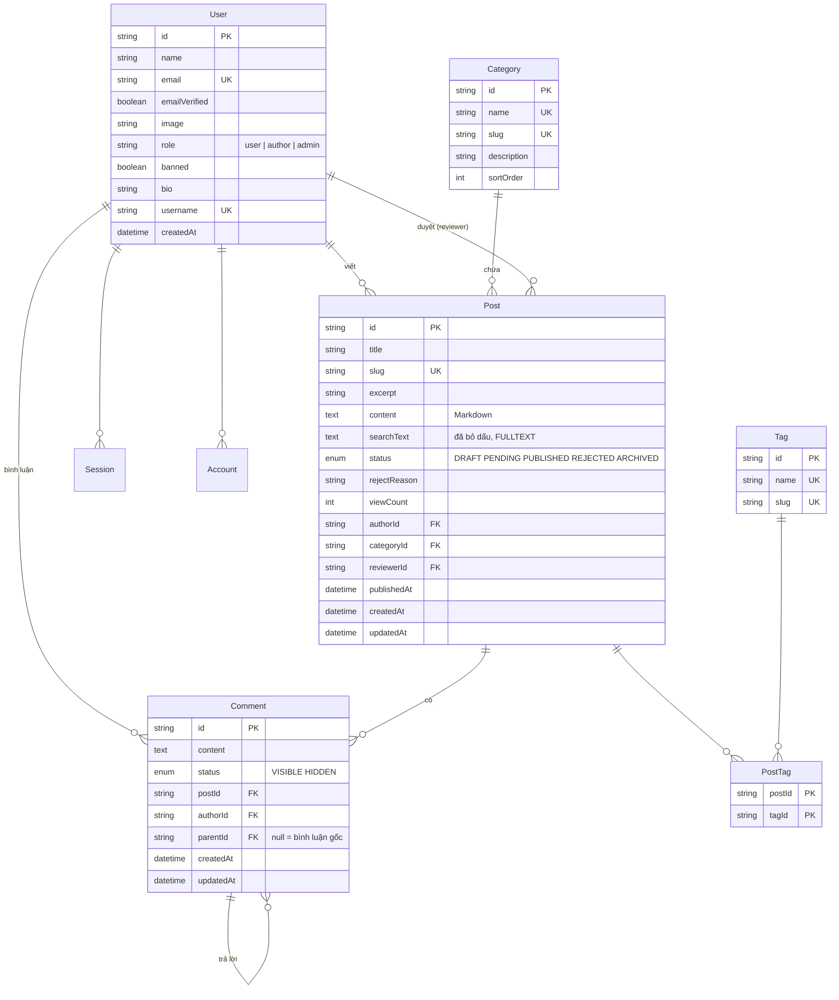

# Cơ sở dữ liệu

MySQL 8.4, bảng mã `utf8mb4`, collation `utf8mb4_0900_ai_ci`. Truy cập qua Prisma. Xem dữ liệu bằng Adminer ở http://localhost:8080 (server: `mysql`, user/mật khẩu trong `.env`).

## Sơ đồ quan hệ

`Session`, `Account`, `Verification` do Better Auth quản lý. Sinh schema của chúng bằng CLI của Better Auth (xem tài liệu bản đã cài), rồi thêm các cột riêng của Xóm Nhỏ (`bio`, `username`) vào model `User`. Plugin admin tự thêm `role`, `banned`, `banReason`, `banExpires`.

Hiện trạng (giai đoạn 2, better-auth 1.7): `session`, `account`, `verification` thêm ở migration `add_better_auth_tables`, cột lấy đúng theo định nghĩa bảng trong mã nguồn Better Auth (bảng core + `session.impersonatedBy` của plugin admin), không dùng CLI vì cấu hình Better Auth nằm trong Nest. Id của bốn bảng auth do Better Auth sinh (32 ký tự), không phải `cuid()`. `username` tự sinh khi đăng ký (từ tên, bỏ dấu, trùng thì thêm số, `infrastructure/auth/username.ts`). Mật khẩu băm nằm ở `account.password` với `providerId = "credential"`; không repository nào đọc bảng `account`, `session`.

Nâng cấp Better Auth lên bản mới: so lại cột với `@better-auth/core/dist/db/get-tables.mjs` và schema của plugin admin; lệch thì tạo migration mới.

Ghi chú cài đặt:

- Tên bảng viết thường, số ít, gạch dưới (`user`, `post`, `post_tag`) qua `@@map`; tên cột giữ camelCase như Better Auth.
- `Post.content` là `MEDIUMTEXT` (16 MB): `TEXT` chỉ 64 KB, bài tiếng Việt dài (mỗi chữ có dấu 2-3 byte) dễ vượt.
- Server MySQL mặc định `utf8mb4_0900_ai_ci`, nhưng Prisma tạo từng bảng với `utf8mb4_unicode_ci` và không theo dõi collation. Giữ nguyên `unicode_ci` cho mọi bảng (không sửa tay migration) để các bảng luôn đồng nhất. Cả hai collation đều không phân biệt dấu khi so sánh, nên cột `UNIQUE` coi "bàn" và "ban" là trùng (hai tag này không cùng tồn tại được). Đây là hành vi mong muốn cho tên tag, danh mục. Tìm kiếm không phụ thuộc collation vì `searchText` đã bỏ dấu sẵn.
- Kết nối qua driver adapter `@prisma/adapter-mariadb` (Prisma 7 bắt buộc dùng adapter). `DATABASE_URL` khai báo trong `prisma.config.ts`, không còn trong `schema.prisma`.

## Quy ước

- Khóa chính: chuỗi `cuid()` (hoặc id do Better Auth sinh cho bảng của nó), không dùng số tự tăng lộ ra URL.
- URL dùng `slug`, không dùng `id`. Slug sinh từ tiêu đề đã bỏ dấu (`shared/src/utils/slugify.ts`), trùng thì thêm hậu tố `-2`, `-3`.
- Mọi bảng có `createdAt`; bảng sửa được có `updatedAt @updatedAt`.
- Xóa bài: xóa thật kèm bình luận (`onDelete: Cascade`). Xóa người dùng: không cho xóa nếu còn bài; dùng `banned` thay thế.
- Enum đặt tên tiếng Anh viết hoa (`PUBLISHED`), tên hiển thị tiếng Việt nằm ở `shared/src/constants`.

## Chỉ mục

| Bảng    | Chỉ mục                             | Phục vụ                         |
| ------- | ----------------------------------- | ------------------------------- |
| Post    | `(status, publishedAt DESC)`        | Trang chủ: bài mới nhất đã đăng |
| Post    | `(categoryId, status, publishedAt)` | Lọc theo danh mục               |
| Post    | `(authorId, status)`                | Bài của tôi, hồ sơ              |
| Post    | `FULLTEXT(searchText)`              | Tìm kiếm                        |
| Comment | `(postId, status, createdAt)`       | Bình luận dưới bài              |
| Comment | `(parentId)`                        | Trả lời                         |
| PostTag | `(tagId)`                           | Lọc theo tag                    |

## Tìm kiếm tiếng Việt

Vấn đề: người dùng hay gõ không dấu ("ban tron"), và collation của MySQL không coi `đ` và `d` là một.

Cách làm:

1. Cột `Post.searchText` = tiêu đề + tóm tắt + tên tag, **chuyển chữ thường, bỏ dấu, đổi `đ` thành `d`** (hàm `removeVietnameseTones` trong `shared`). Cập nhật mỗi khi tạo/sửa bài.
2. `FULLTEXT` index trên `searchText`. Docker đã đặt `innodb_ft_min_token_size=1` để không bỏ sót từ ngắn như "ăn", "đi".
3. Từ khóa người dùng gõ cũng đi qua cùng hàm bỏ dấu rồi tìm bằng `MATCH ... AGAINST (... IN BOOLEAN MODE)`.
4. Nếu Prisma chưa hỗ trợ đủ cú pháp cần dùng, viết truy vấn tìm kiếm bằng `$queryRaw` có tham số (không nối chuỗi).

Lưu ý: `innodb_ft_min_token_size` chỉ áp dụng cho index tạo **sau** khi MySQL chạy với cấu hình đó. Nếu đổi cấu hình khi đã có index, phải tạo lại index.

## Phân trang

- Danh sách bài (trang chủ, danh mục, tag, tìm kiếm): phân trang theo số trang (`?page=2`), 10 bài/trang, trả kèm tổng số để vẽ thanh phân trang trên web.
- App: dùng cùng API, cuộn vô hạn bằng cách tăng `page`.
- Bình luận: lấy hết bình luận gốc theo thời gian, mỗi bình luận gốc kèm các trả lời. Trả lời chỉ một cấp: trả lời một trả lời thì vẫn gắn vào bình luận gốc (lưu `parentId` = id bình luận gốc), giao diện hiện "@tên" ở đầu.

## Dữ liệu mẫu (seed)

`backend/prisma/seed.ts` tạo:

- 1 trưởng xóm, 2 cây bút, 3 hàng xóm (mật khẩu ghi trong file seed, chỉ dùng ở máy dev)
- 5 danh mục: Đời sống, Công nghệ, Học tập, Góc kể chuyện, Hỏi đáp
- khoảng 15 tag, 30 bài ở đủ các trạng thái, 100 bình luận có trả lời
