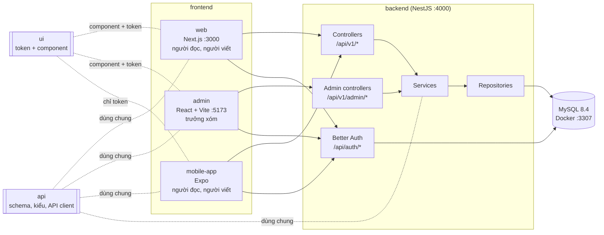

# Kiến trúc

## Tổng quan

Xóm Nhỏ gồm **một backend** và **ba frontend**. Mọi frontend đều nói chuyện với backend qua REST API; không frontend nào chạm vào database.



| Phần                   | Công nghệ                                    | Cổng dev     | Ai dùng                                            |
| ---------------------- | -------------------------------------------- | ------------ | -------------------------------------------------- |
| `backend/`             | NestJS, Prisma, Better Auth                  | 4000         | các frontend                                       |
| `frontend/web/`        | Next.js App Router                           | 3000         | khách, hàng xóm, cây bút                           |
| `frontend/admin/`      | React + Vite (SPA)                           | 5173         | trưởng xóm                                         |
| `frontend/mobile-app/` | Expo, Expo Router                            | 8081 (Metro) | khách, hàng xóm, cây bút                           |
| `frontend/ui/`         | Token thiết kế + component React (shadcn/ui) |              | web, admin (component + token), mobile (chỉ token) |
| `api/`                 | Zod, TypeScript                              |              | cả bốn                                             |
| MySQL / Adminer        | Docker                                       | 3307 / 8080  | backend / bạn                                      |

## Nguyên tắc

1. **Backend là nơi duy nhất giữ quy tắc nghiệp vụ và chạm database.** Frontend chỉ hiển thị và gửi yêu cầu. Muốn đổi "ai được làm gì" thì chỉ sửa backend.
2. **Phụ thuộc chỉ đi một chiều.**

   ```
   frontend/*  ──>  ui  ──>  (không phụ thuộc gì trong repo)
        │
        └─────>  api  <──  backend
   ```

   - `api` và `ui` không import gì từ `backend` hay `frontend`.
   - `backend` không import `ui`.
   - Các frontend không import lẫn nhau. Thứ gì hai frontend cùng cần thì chuyển vào `ui` (nếu là giao diện) hoặc `api` (nếu là logic, kiểu).

3. **Một hợp đồng API.** Schema Zod và kiểu phản hồi nằm trong `api`. Backend dùng schema đó để kiểm tra dữ liệu vào; frontend dùng cùng schema để kiểm tra form và dùng `api/src/api-client` để gọi API có kiểu. Đổi API là TypeScript báo lỗi ở mọi nơi bị ảnh hưởng.
4. **Chia theo tính năng, không theo loại file.** Trong mỗi phần, code của "bài viết" nằm chung một chỗ (`modules/posts`, `features/posts`), thay vì rải ra `controllers/`, `components/`, `hooks/` riêng. Thêm hay bỏ một tính năng chỉ đụng một thư mục.
5. **Trang quản trị là một app riêng.** Tách khỏi web để: web nhẹ hơn, không lộ mã nguồn trang quản trị cho người dùng thường, deploy và phân quyền truy cập riêng được.

## Cây thư mục

```
xom-nho/
├── backend/                       NestJS API
│   ├── prisma.config.ts           trỏ tới database/prisma
│   ├── scripts/                   seed.ts (dữ liệu mẫu)
│   ├── src/
│   │   ├── main.ts                khởi động, CORS, gắn Better Auth
│   │   ├── app.module.ts
│   │   ├── config/                đọc + kiểm tra biến môi trường (Zod)
│   │   ├── common/                dùng chung cho mọi module
│   │   │   ├── decorators/        @CurrentUser, @Roles, @Public
│   │   │   ├── guards/            AuthGuard, RolesGuard
│   │   │   ├── pipes/             ZodValidationPipe
│   │   │   ├── filters/           đổi lỗi thành { error: { code, message } }
│   │   │   ├── interceptors/      bọc kết quả thành { data, meta }
│   │   │   └── utils/
│   │   ├── infrastructure/        kết nối ra ngoài
│   │   │   ├── database/          PrismaModule, PrismaService
│   │   │   ├── auth/              cấu hình Better Auth
│   │   │   ├── rate-limit/
│   │   │   ├── storage/           StorageService: đọc ghi file trong media/
│   │   │   └── logger/
│   │   └── modules/               mỗi tính năng một module
│   │       ├── auth/              phiên hiện tại, /me
│   │       ├── users/
│   │       ├── posts/
│   │       ├── comments/
│   │       ├── categories/
│   │       ├── tags/
│   │       ├── search/
│   │       └── dashboard/         số liệu cho admin
│   └── test/                      e2e/, fixtures/
│
├── frontend/
│   ├── web/                       Next.js
│   │   ├── src/
│   │   │   ├── app/               chỉ định tuyến: page, layout, loading, error
│   │   │   ├── features/          posts/, comments/, auth/, search/, profile/, editor/
│   │   │   ├── components/        layout/ (header, footer), common/
│   │   │   ├── lib/               gọi backend từ server, auth client
│   │   │   ├── hooks/
│   │   │   └── styles/
│   │   ├── e2e/                   Playwright
│   │   └── public/
│   │
│   ├── admin/                     React + Vite
│   │   └── src/
│   │       ├── app/               router, providers, layout/ (sidebar, topbar)
│   │       ├── features/          dashboard/, moderation/, posts/, comments/,
│   │       │                      categories/, tags/, users/, auth/
│   │       ├── components/        data-table/, common/
│   │       ├── lib/
│   │       ├── hooks/
│   │       └── styles/
│   │
│   └── mobile-app/                Expo
│       ├── app/                   chỉ định tuyến (Expo Router)
│       ├── src/
│       │   ├── features/          posts/, comments/, auth/, search/, profile/, editor/
│       │   ├── components/
│       │   ├── hooks/
│       │   ├── lib/
│       │   └── theme/             đọc token từ ui
│       └── assets/
│   │
│   └── ui/                        design system (@xom-nho/ui)
│       └── src/
│           ├── tokens/                màu, chữ, khoảng cách, bo góc (TS thuần, mobile dùng được)
│           ├── styles/                theme.css cho Tailwind v4 (web, admin)
│           ├── components/            shadcn/ui: button, input, dialog, table... (web, admin)
│           ├── hooks/
│           └── lib/                   cn()
│
├── api/                           hợp đồng API (@xom-nho/api), dùng chung mọi nơi
│   └── src/
│       ├── schemas/               Zod: dữ liệu vào
│       ├── types/                 kiểu phản hồi API, Result
│       ├── constants/             vai trò, trạng thái, giới hạn, messages tiếng Việt
│       ├── utils/                 slugify, removeVietnameseTones, formatRelativeTime
│       └── api-client/            hàm gọi /api/v1 có kiểu, chạy trên trình duyệt, Node, React Native
│
├── database/                      dữ liệu
│   ├── docker-compose.yml         MySQL + Adminer cho máy dev
│   ├── mysql/init/                script chạy lần đầu tạo container
│   └── prisma/                    schema.prisma, migrations/
│
├── media/                         ảnh, video người dùng tải lên (UPLOAD_DIR, gitignore, ADR 0005)
│   ├── images/                    ảnh trong bài
│   ├── videos/                    video trong bài
│   └── avatars/                   ảnh đại diện (chưa dùng)
│
├── docs/                          tài liệu thiết kế
│   └── design-system/xom-nho/     MASTER.md + override admin, mobile
├── config/                        tsconfig.base.json
└── .claude/                       cấu hình Claude Code
```

## Cấu trúc bên trong một module backend

```
backend/src/modules/posts/
├── posts.module.ts
├── posts.controller.ts            /api/v1/posts         (hàng xóm, cây bút; khách nhận 401)
├── posts.admin.controller.ts      /api/v1/admin/posts   (chỉ admin)
├── posts.service.ts               quy tắc nghiệp vụ, kiểm tra quyền
├── posts.repository.ts            truy vấn Prisma, không có quy tắc
├── posts.mapper.ts                Prisma model -> kiểu trong api
├── posts.policy.ts                canEdit, canPublishDirectly...
└── posts.service.spec.ts          test
```

Controller công khai và controller admin dùng **chung service**, nên quy tắc không bị viết hai lần. Mỗi tầng chỉ gọi tầng ngay dưới: controller → service → repository → Prisma.

Việc chạy định kỳ đặt trong `<tài-nguyên>.scheduler.ts` (`@Cron` của `@nestjs/schedule`, `ScheduleModule.forRoot()` ở `app.module.ts`). Scheduler giống controller, chỉ gọi service, không chứa quy tắc. Ví dụ: `files.scheduler.ts` dọn file không gắn bài mỗi giờ.

## Cấu trúc bên trong một feature frontend

```
frontend/web/src/features/posts/
├── components/                    PostCard, PostList, PostContent...
├── api/                           hàm lấy dữ liệu (server) và hook TanStack Query (client)
├── hooks/
└── index.ts                       chỉ export những gì nơi khác được dùng
```

Trang trong `app/` chỉ ghép các feature lại, không chứa logic. Feature này không import thẳng vào bên trong feature khác; dùng qua `index.ts`.

## Đăng nhập

Better Auth chạy trong backend ở `/api/auth/*`.

- **web, admin**: cookie phiên do backend đặt. Gọi API với `credentials: "include"`. Backend bật CORS cho đúng các origin của web và admin, và khai báo chúng trong `trustedOrigins` của Better Auth.
- **web (Server Components)**: khi render ở server, Next.js chuyển tiếp cookie của người dùng sang backend (`lib/server-api.ts`).
- **mobile-app**: plugin Expo của Better Auth, phiên lưu trong `expo-secure-store`, tự gửi kèm request.
- **admin**: sau khi đăng nhập, kiểm tra `role === "admin"`; không phải thì đăng xuất và báo lỗi. Backend vẫn tự kiểm tra trên mọi route `/admin/*`.

Khi deploy: dùng chung tên miền gốc (`xomnho.vn`, `admin.xomnho.vn`, `api.xomnho.vn`) để cookie hoạt động ổn định giữa các trang.

## Luồng tiêu biểu: hàng xóm đăng bài từ app

1. App kiểm tra form bằng `createPostSchema` (từ `api`).
2. Gọi `api.posts.create(input)` (từ `api/api-client`) → `POST /api/v1/posts`.
3. `AuthGuard` lấy phiên qua Better Auth, gắn user vào request.
4. `ZodValidationPipe` kiểm tra body bằng cùng `createPostSchema`.
5. `PostsService.create` dùng `PostsPolicy` xác định trạng thái: `user` → `PENDING`, `author`/`admin` → `PUBLISHED`; kiểm tra giới hạn tần suất.
6. `PostsRepository` ghi bài và tag trong một transaction.
7. `PostsMapper` chuyển sang `PostDetail`; interceptor bọc thành `{ data }`.
8. Trưởng xóm thấy bài trong hàng chờ của `admin` (gọi `GET /api/v1/admin/posts?status=PENDING`).
