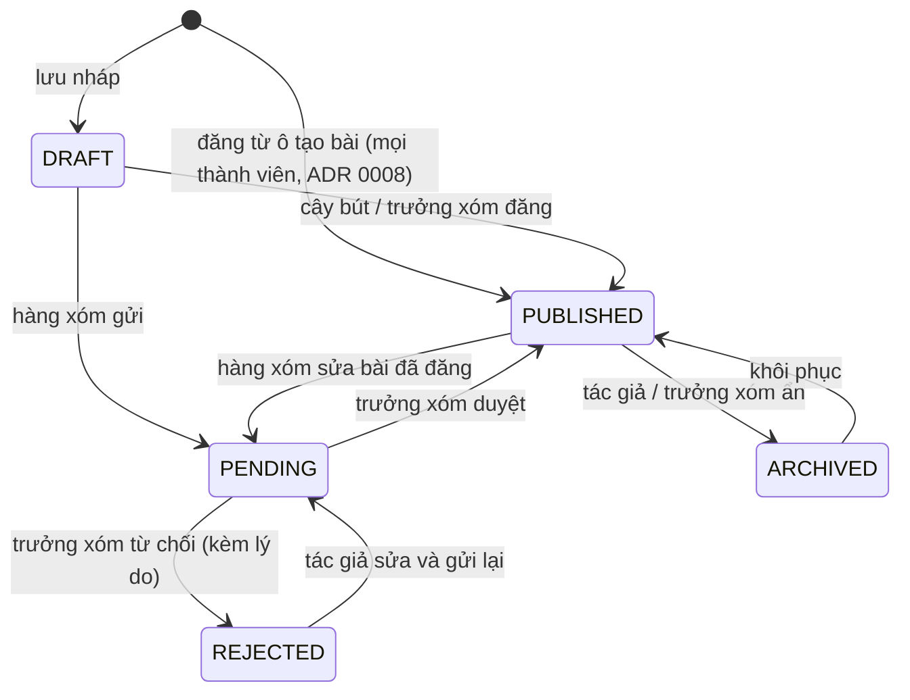

# Phân quyền

## Vai trò

| Mã (trong code) | Tên hiển thị   | Ai                                                   |
| --------------- | -------------- | ---------------------------------------------------- |
| (khách)         | Khách ghé chơi | Chưa đăng nhập: chỉ thấy trang chào mừng (ADR 0007)  |
| `user`          | Hàng xóm       | Mặc định khi đăng ký                                 |
| `author`        | Cây bút        | Hàng xóm được admin nâng quyền vì viết tốt, đáng tin |
| `admin`         | Trưởng xóm     | Quản trị                                             |

Vai trò lưu ở cột `role` của bảng `user` (plugin admin của Better Auth). Người bị cấm (`banned = true`) không đăng nhập được; phiên cũ còn lại thì mọi route cần đăng nhập trả 403, kể cả route đọc.

## Ma trận quyền

| Hành động                               | Khách | Hàng xóm | Cây bút | Trưởng xóm |
| --------------------------------------- | :---: | :------: | :-----: | :--------: |
| Xem trang chào mừng, đăng ký, đăng nhập |  ✅   |          |         |            |
| Xem bài đã đăng, bình luận đang hiện    |       |    ✅    |   ✅    |     ✅     |
| Tìm kiếm, lọc theo danh mục/tag         |       |    ✅    |   ✅    |     ✅     |
| Xem hồ sơ hàng xóm                      |       |    ✅    |   ✅    |     ✅     |
| Bình luận, trả lời bình luận            |       |    ✅    |   ✅    |     ✅     |
| Sửa/xóa bình luận của mình              |       |    ✅    |   ✅    |     ✅     |
| Thích / bỏ thích bài đã đăng            |       |    ✅    |   ✅    |     ✅     |
| Không thích / bỏ (ADR 0009)             |       |    ✅    |   ✅    |     ✅     |
| Viết bài, kèm ảnh/video (đăng thẳng)    |       |    ✅    |   ✅    |     ✅     |
| Tải ảnh, video lên                      |       |    ✅    |   ✅    |     ✅     |
| Xem ảnh, video của bài đã đăng          |       |    ✅    |   ✅    |     ✅     |
| Đổi, xóa ảnh đại diện của mình          |       |    ✅    |   ✅    |     ✅     |
| Xem ảnh đại diện của người khác         |       |    ✅    |   ✅    |     ✅     |
| Sửa bài của mình                        |       |    ✅    |   ✅    |     ✅     |
| Xóa bài của mình                        |       |    ✅    |   ✅    |     ✅     |
| Tạo tag mới khi viết bài                |       |          |   ✅    |     ✅     |
| Duyệt / từ chối bài (tạm không dùng)    |       |          |         |     ✅     |
| Ẩn / hiện bài bất kỳ (ẩn kèm lý do)     |       |          |         |     ✅     |
| Ẩn / hiện / xóa bình luận bất kỳ        |       |          |         |     ✅     |
| Sửa / xóa bài bất kỳ                    |       |          |         |     ✅     |
| Quản lý danh mục, tag                   |       |          |         |     ✅     |
| Đổi vai trò, cấm người dùng             |       |          |         |     ✅     |
| Đăng nhập app admin                     |       |          |         |     ✅     |

Hàng xóm chỉ được gắn tag đã có; cây bút và trưởng xóm được tạo tag mới.

Khách không đọc được gì (ADR 0007): backend trả 401 cho mọi route đọc dữ liệu, chỉ mở `GET /health` và `GET /auth/providers`. Web hiện trang chào mừng ở `/` và chuyển các trang khác sang đăng nhập (`frontend/web/src/proxy.ts`).

## Trạng thái bài viết

Từ ADR 0008 mọi thành viên đăng thẳng: bài soạn ở trang chủ vào thẳng `PUBLISHED`. Các trạng thái chờ duyệt bên dưới giữ cho bài cũ và trình soạn Markdown sau này (nếu bật lại duyệt bài).

Bài viết, sửa và xóa (`posts.policy.ts`, `canModify`): qua route thường chỉ tác giả, ở mọi trạng thái (kể cả bài bị ẩn); bài đã đăng của người khác trả 403, bài ẩn của người khác trả 404. Trưởng xóm sửa, xóa bài bất kỳ bằng route admin (giai đoạn 5).

Bình luận (`comments.policy.ts`): bình luận đã ẩn chỉ trưởng xóm thấy (người viết cũng không); sửa, xóa chỉ người viết và khi bình luận còn hiện; bài chứa bình luận phải xem được (bài đã ẩn chỉ chủ bài, trưởng xóm mở, và không nhận bình luận mới).

Thích bài (`posts.policy.ts`, `canLike`): mọi thành viên không bị cấm, kể cả tác giả tự thích bài mình, chỉ với bài đã đăng. Bài đã ẩn: chủ bài và trưởng xóm nhận 403, người khác 404 (như mọi route đọc). Bỏ thích chỉ cần xem được bài, kể cả bài đã ẩn. Trên thẻ bài, bình luận xem trước chỉ gồm bình luận đang hiện, kể cả với trưởng xóm.

Không thích bài (`canDislike`, ADR 0009): cùng điều kiện với Thích. Thích và Không thích loại trừ nhau; số Không thích ai cũng thấy.

Ảnh, video (`GET /files/:id`): ảnh đại diện và file trong bài đã đăng thì mọi thành viên xem; file chưa gắn bài hoặc thuộc bài chưa đăng chỉ người tải lên và trưởng xóm xem (`files.policy.ts`).



Trưởng xóm ẩn bài (`POST /admin/posts/:id/archive`) thì bắt buộc ghi lý do, lưu ở `rejectReason`; tác giả thấy lý do trên bài của mình, hiện lại thì lý do bị xóa (chốt 2026-11-13, `pages/admin.md` mục "Ẩn bài"). Chỉ ẩn được bài đang hiện, chỉ hiện lại được bài đang ẩn (`PostsPolicy.canArchive`, `canRestore`), sai trạng thái thì 409.

## Trưởng xóm quản lý thành viên

Theo `users.policy.ts` (chốt 2026-11-13):

- Không tự đổi vai trò của mình, không tự cấm mình (403). Tránh trường hợp tự hạ quyền rồi không còn ai là trưởng xóm.
- Không cấm trưởng xóm khác (403), nhưng hạ vai trò họ thì được. Muốn cấm thì hạ vai trò trước, để không cấm nhầm.
- Cấm bắt buộc có lý do, hạn tùy chọn (bỏ trống là vĩnh viễn). Cấm xong thì mọi phiên của người đó bị xóa: họ bị đăng xuất ngay, đăng nhập lại nhận 403 kèm lý do. Hết hạn thì tự mở, không cần bỏ cấm.
- Đổi vai trò có hiệu lực ngay ở request sau (phiên đọc lại bảng `user`, không có cookie cache).
- Route quản trị có sẵn của Better Auth (`/api/auth/admin/*`) đã tắt (404): mọi thao tác quản trị đi qua `/api/v1/admin/*` để qua được các quy tắc trên.
- `GET /admin/users` (và `GET /admin/users/:id`) là **các route duy nhất trả `email` của người khác**, để trưởng xóm tìm thành viên theo email. Mọi route khác chỉ trả `UserSummary` (không email).

Chỉ bài `PUBLISHED` hiện cho người khác. Tác giả luôn xem được bài của mình ở mọi trạng thái.

## Cách kiểm tra quyền trong code

Mọi kiểm tra nằm ở `backend`, chia ba lớp:

| Lớp                              | Ở đâu                                                   | Kiểm tra gì                                                                              |
| -------------------------------- | ------------------------------------------------------- | ---------------------------------------------------------------------------------------- |
| `AuthGuard` (toàn cục)           | `backend/src/common/guards/auth.guard.ts`               | Có phiên chưa (trừ route `@Public()`: chỉ `/health`, `/auth/providers`), có bị cấm không |
| `RolesGuard` + `@Roles("admin")` | `backend/src/common/guards/roles.guard.ts`              | Vai trò, gắn ở cấp class cho mọi `*.admin.controller.ts`                                 |
| Policy                           | `backend/src/modules/<tính-năng>/<tính-năng>.policy.ts` | Quyền trên **một bản ghi cụ thể**, service gọi trước khi ghi                             |

```ts
// Ví dụ chữ ký hàm trong posts.policy.ts, chưa phải code thật
canView(user: SessionUser | null, post: Post): boolean        // bài đã đăng, hoặc chủ bài, hoặc admin
canEdit(user: SessionUser, post: Post): boolean               // chủ bài hoặc admin
canPublishDirectly(user: SessionUser): boolean                // author hoặc admin
canCreateTag(user: SessionUser): boolean                      // author hoặc admin
```

Quy tắc: **frontend không quyết định quyền**. Web, admin, mobile chỉ dựa vào `role` để ẩn/hiện nút cho tiện; backend luôn kiểm tra lại. App admin chặn người không phải admin ngay khi đăng nhập, nhưng chỗ chặn thật là `RolesGuard`.
