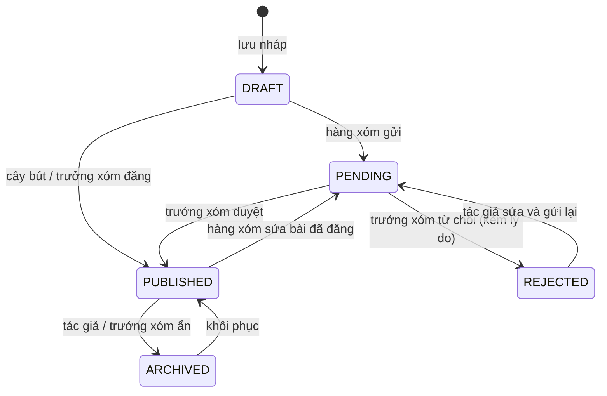

# Phân quyền

## Vai trò

| Mã (trong code) | Tên hiển thị   | Ai                                                   |
| --------------- | -------------- | ---------------------------------------------------- |
| (khách)         | Khách ghé chơi | Chưa đăng nhập                                       |
| `user`          | Hàng xóm       | Mặc định khi đăng ký                                 |
| `author`        | Cây bút        | Hàng xóm được admin nâng quyền vì viết tốt, đáng tin |
| `admin`         | Trưởng xóm     | Quản trị                                             |

Vai trò lưu ở cột `role` của bảng `user` (plugin admin của Better Auth). Người bị cấm (`banned = true`) không đăng nhập được.

## Ma trận quyền

| Hành động                            | Khách |       Hàng xóm        |     Cây bút     |   Trưởng xóm    |
| ------------------------------------ | :---: | :-------------------: | :-------------: | :-------------: |
| Xem bài đã đăng, bình luận đang hiện |  ✅   |          ✅           |       ✅        |       ✅        |
| Tìm kiếm, lọc theo danh mục/tag      |  ✅   |          ✅           |       ✅        |       ✅        |
| Bình luận, trả lời bình luận         |       |          ✅           |       ✅        |       ✅        |
| Sửa/xóa bình luận của mình           |       |          ✅           |       ✅        |       ✅        |
| Viết bài                             |       |    ✅ (chờ duyệt)     | ✅ (đăng thẳng) | ✅ (đăng thẳng) |
| Sửa bài của mình                     |       | ✅ (về lại chờ duyệt) |       ✅        |       ✅        |
| Xóa bài của mình                     |       |          ✅           |       ✅        |       ✅        |
| Tạo tag mới khi viết bài             |       |                       |       ✅        |       ✅        |
| Duyệt / từ chối bài                  |       |                       |                 |       ✅        |
| Ẩn / hiện bình luận bất kỳ           |       |                       |                 |       ✅        |
| Sửa / xóa bài bất kỳ                 |       |                       |                 |       ✅        |
| Quản lý danh mục, tag                |       |                       |                 |       ✅        |
| Đổi vai trò, cấm người dùng          |       |                       |                 |       ✅        |
| Đăng nhập app admin                  |       |                       |                 |       ✅        |

Hàng xóm chỉ được gắn tag đã có; cây bút và trưởng xóm được tạo tag mới.

## Trạng thái bài viết



Chỉ bài `PUBLISHED` hiện cho người khác. Tác giả luôn xem được bài của mình ở mọi trạng thái.

## Cách kiểm tra quyền trong code

Mọi kiểm tra nằm ở `backend`, chia ba lớp:

| Lớp                              | Ở đâu                                                   | Kiểm tra gì                                                  |
| -------------------------------- | ------------------------------------------------------- | ------------------------------------------------------------ |
| `AuthGuard` (toàn cục)           | `backend/src/common/guards/auth.guard.ts`               | Có phiên chưa (trừ route `@Public()`), có bị cấm không       |
| `RolesGuard` + `@Roles("admin")` | `backend/src/common/guards/roles.guard.ts`              | Vai trò, gắn ở cấp class cho mọi `*.admin.controller.ts`     |
| Policy                           | `backend/src/modules/<tính-năng>/<tính-năng>.policy.ts` | Quyền trên **một bản ghi cụ thể**, service gọi trước khi ghi |

```ts
// Ví dụ chữ ký hàm trong posts.policy.ts, chưa phải code thật
canView(user: SessionUser | null, post: Post): boolean        // bài đã đăng, hoặc chủ bài, hoặc admin
canEdit(user: SessionUser, post: Post): boolean               // chủ bài hoặc admin
canPublishDirectly(user: SessionUser): boolean                // author hoặc admin
canCreateTag(user: SessionUser): boolean                      // author hoặc admin
```

Quy tắc: **frontend không quyết định quyền**. Web, admin, mobile chỉ dựa vào `role` để ẩn/hiện nút cho tiện; backend luôn kiểm tra lại. App admin chặn người không phải admin ngay khi đăng nhập, nhưng chỗ chặn thật là `RolesGuard`.
